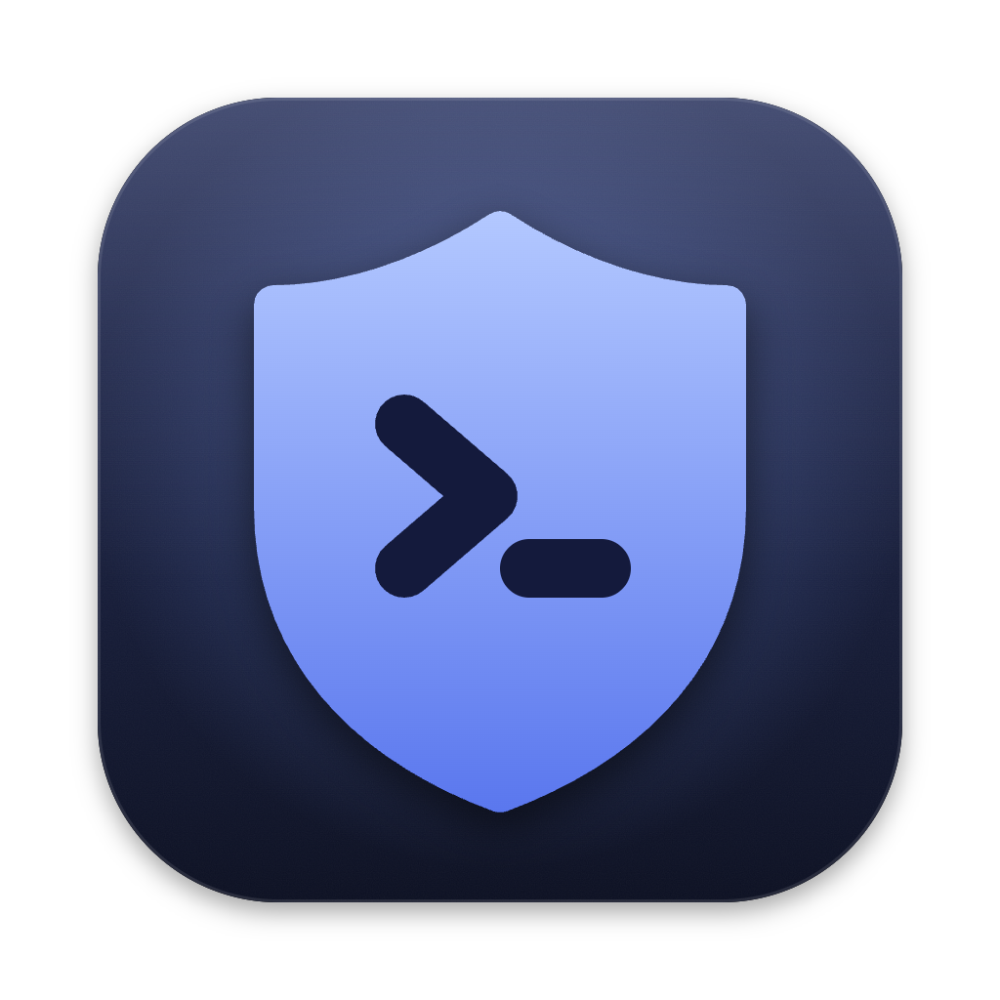
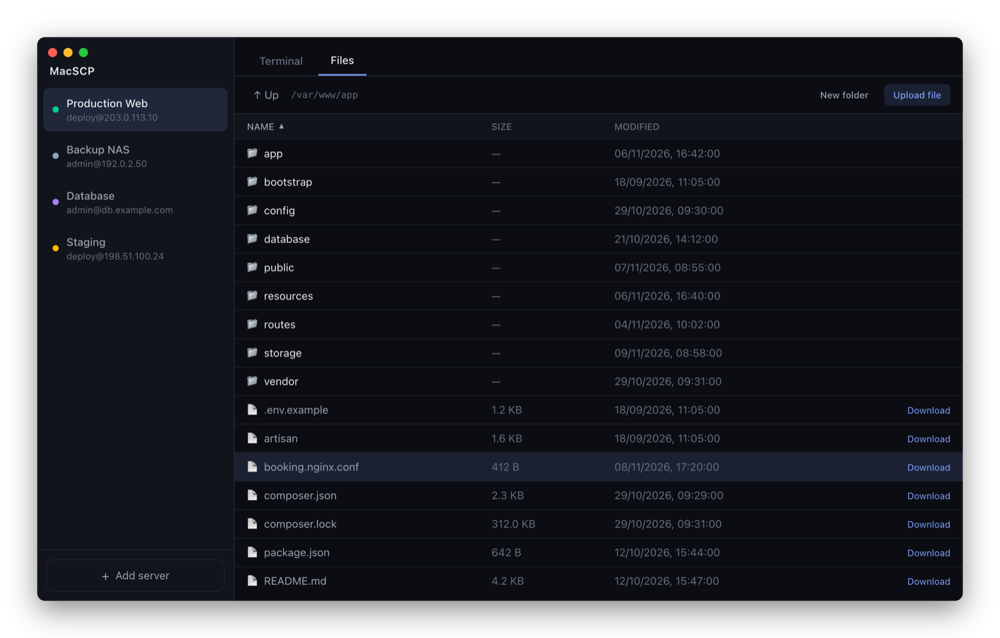
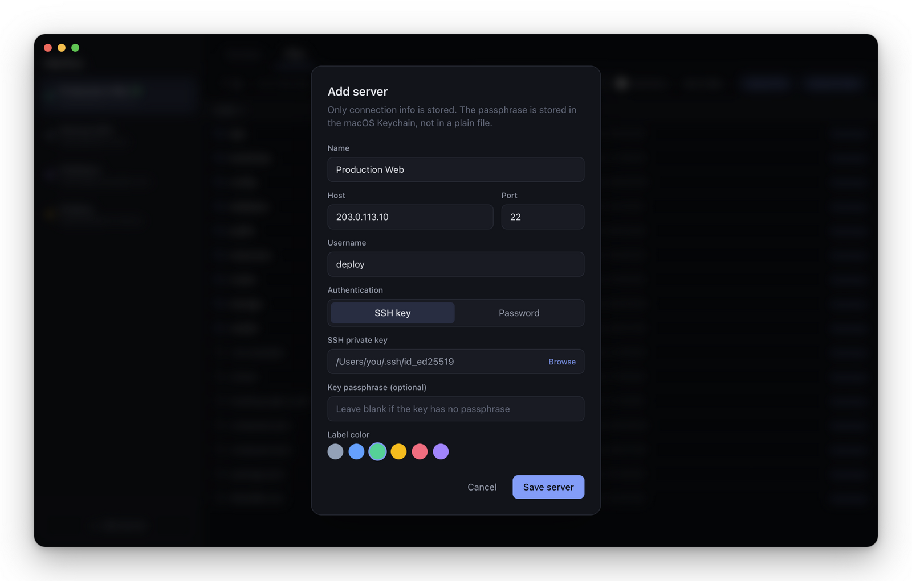
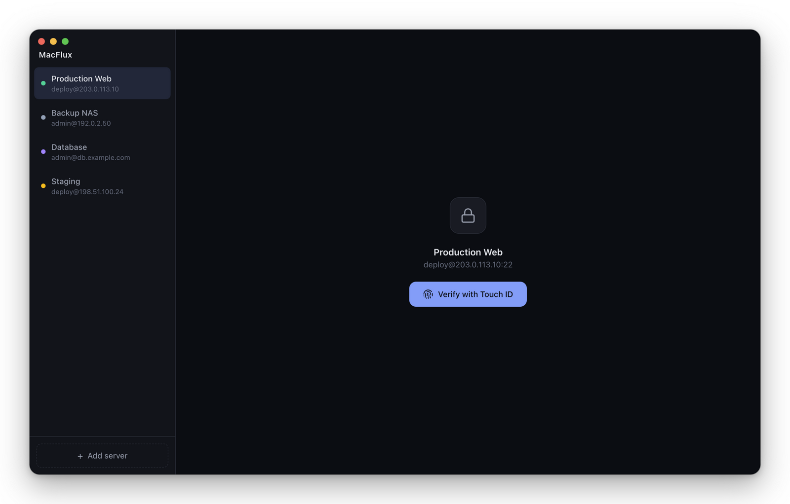
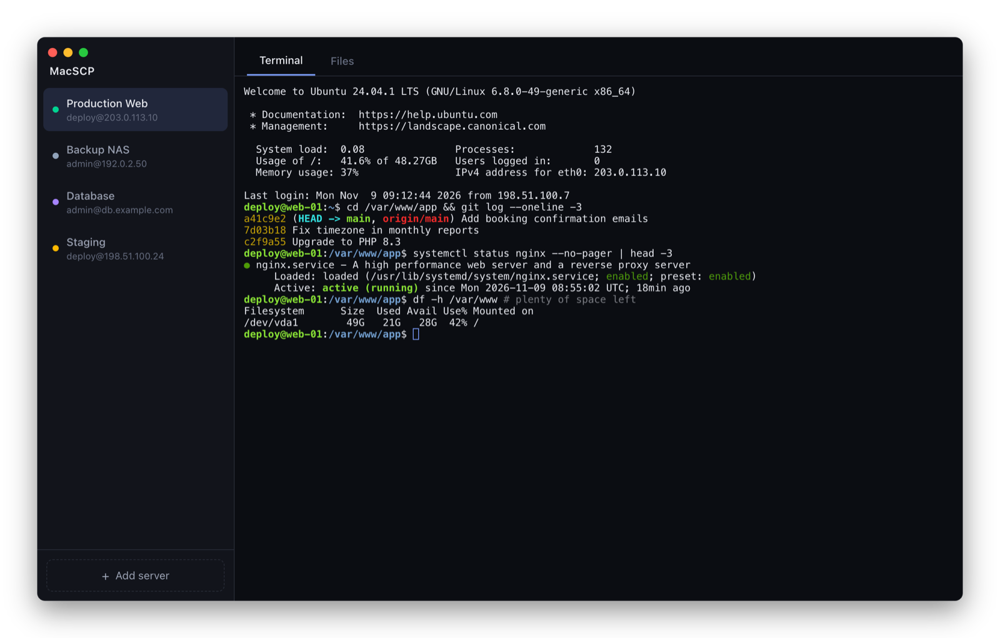
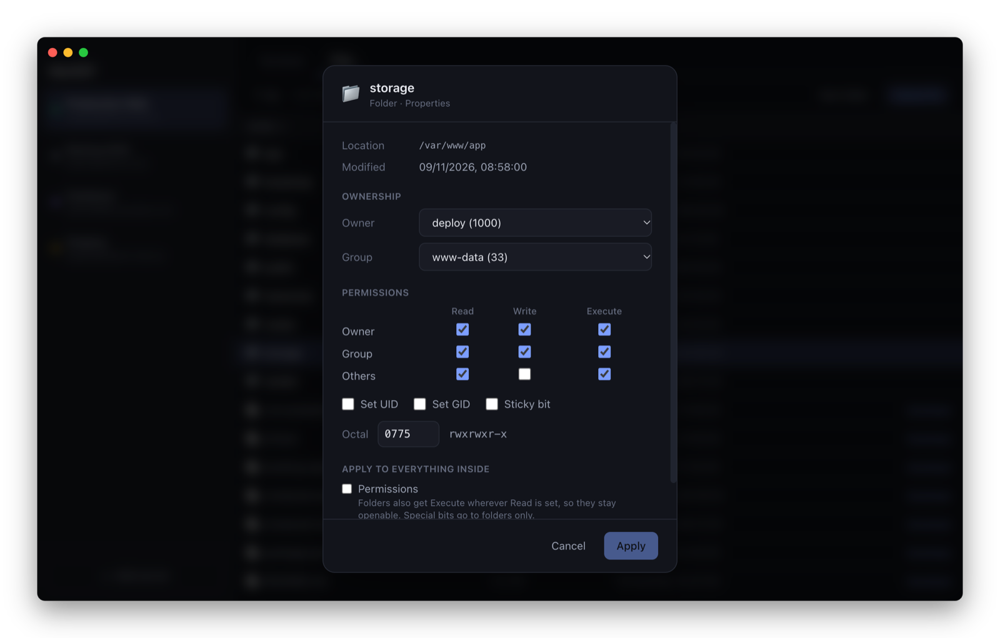
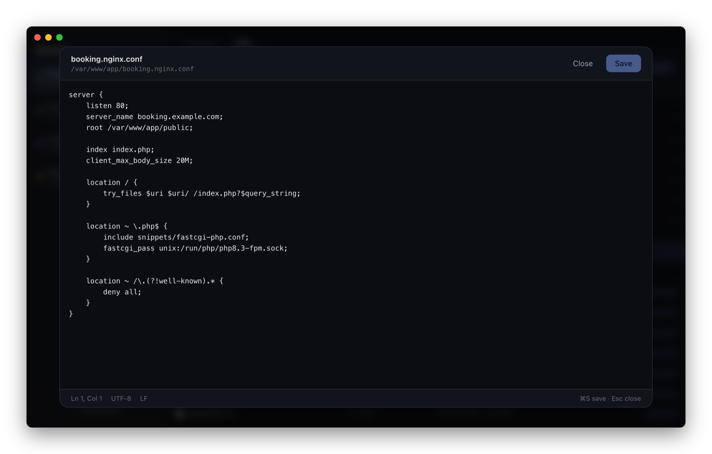

<p align="center">
  
</p>

<h1 align="center">MacSCP</h1>

<p align="center">
  A WinSCP-style SSH terminal and SFTP file manager for macOS, unlocked with Touch ID.
</p>

<p align="center">
  
</p>

## Why MacSCP?

On Windows, WinSCP is the go-to tool for looking after servers: browse files, upload and download, edit config files, fix permissions, and open a terminal when you need one. MacSCP brings that same workflow to the Mac.

- **Terminal and files in one window.** Each server gets an SSH terminal tab and an SFTP file browser tab.
- **Touch ID before every connection.** Nobody can open your servers from your Mac without your fingerprint.
- **Upload files and whole folders.** Use **Upload file** or **Upload folder**, or drag them from Finder onto the Files tab.
- **Download files and whole folders.** Right-click → **Download…**, and a folder comes down with everything inside it.
- **Transfer progress like WinSCP.** Percentage, time elapsed, time left and speed for uploads and downloads, and a clear "complete" when they finish.
- **Right-click menus like WinSCP.** Edit, Download, Rename, Delete, Copy Path and Properties.
- **Properties like WinSCP.** Change permissions (checkboxes or octal), owner and group, for one item or everything inside a folder.
- **Built-in editor.** Edit files on the server and save with ⌘S. Line endings and file permissions are kept, and you're warned if someone else changed the file in the meantime.
- **Host key checking.** You confirm each server's fingerprint once; MacSCP warns you if it ever changes.

## Requirements

- A Mac with Touch ID (MacBook, or a Magic Keyboard with Touch ID)
- [Node.js](https://nodejs.org) 20.19 or newer (24 LTS recommended)
- Xcode Command Line Tools: `xcode-select --install`

## Install

MacSCP isn't on the App Store, so you build it once on your own Mac:

```bash
git clone https://github.com/yusoffnike01/MacSCP.git
cd MacSCP
npm install
npm run install:app
```

This builds **MacSCP.app** and puts it in your **Applications** folder. Open it from Launchpad or Spotlight (⌘ Space, type "MacSCP").

To update later, quit MacSCP (⌘Q) and run:

```bash
git pull && npm install && npm run install:app
```

## How to use

### 1. Add a server

Click **+ Add server** at the bottom of the sidebar and fill in the server's address and your username. Then, under **Authentication**, choose how you log in:

- **SSH key**: choose your private key file (for example `~/.ssh/id_ed25519`). If your key has a passphrase, enter it once.
- **Password**: enter the server password once.

MacSCP keeps the password or passphrase in the macOS Keychain.



### 2. Connect with Touch ID

Click the server in the sidebar, then **Verify with Touch ID**. Once connected, a pulsing green dot appears next to the server's name; it goes away if the connection drops.

The first time you connect to a server, MacSCP shows its **fingerprint** (for example `SHA256:aIUAFOAY…`) and asks if you trust it. To be sure it's the right server, compare it with the output of `ssh-keygen -lf /etc/ssh/ssh_host_ed25519_key.pub` on the server. After that, MacSCP connects straight away, and warns you if the fingerprint ever changes.



### 3. Use the terminal

The **Terminal** tab is a full SSH terminal. It resizes with the window and keeps running while you switch to the Files tab.



### 4. Manage files

The **Files** tab shows the files on the server.

- Click a folder to open it, and **↑ Up** to go back.
- Click a column title (Name, Size, Modified) to sort; click again to reverse.
- Use **New folder**, **Upload file** and **Upload folder** at the top. Uploads go into the folder you're in, and a folder goes up with everything inside it.
- You can also drag files or folders from Finder onto the list to upload them.
- To download, right-click a file or folder and choose **Download…** (or click **Download** at the end of its row). A file asks where to save it; a folder asks which folder on your Mac to save it in, and comes down with everything inside it.
- Uploads and downloads show a progress window: the percentage done, time elapsed, time left and speed. When the transfer is finished it turns green and says **Upload complete** or **Download complete** (with **Show in Finder** for downloads), and stays until you click OK.
- **Stop** ends a download at once: files already saved are kept, and any file only partly saved is deleted. An upload stops once the files being sent at that moment are finished, so none is left half-written on the server.
- Double-click a file to edit it.

If something you upload is already on the server, MacSCP asks before replacing it. A folder is merged: files with the same names are replaced, and any other files already in it are kept. Finder's `.DS_Store` files and symbolic links inside uploaded folders aren't uploaded.

Downloading a folder works the same way: if your Mac already has a folder with that name there, MacSCP asks before adding to it. Some things inside a downloaded folder are left out, and listed when the download is done:

- symbolic links and special files (sockets, pipes, devices)
- files and folders your login isn't allowed to read, or that were deleted or changed on the server while downloading
- names that differ only in upper and lower case (`README` and `readme`): your Mac sees them as the same name, so only the first is saved

Right-click for more:

| Right-click on   | You get                                                                  |
| ---------------- | ------------------------------------------------------------------------ |
| A file           | Edit · Download… · Rename… · Delete… · Copy Path · Properties…           |
| A folder         | Open · Download… · Rename… · Delete… · Copy Path · Properties…           |
| Empty space      | New Folder… · Upload File… · Upload Folder… · Refresh · Copy Path · Properties… |
| A server (sidebar) | Edit… · Rename… · Delete…                                              |

Deleting always asks first. Deleting a folder removes everything inside it.

### 5. Change permissions and owner

Right-click a file or folder and choose **Properties…**. Tick the Read / Write / Execute boxes or type an octal value like `755`, and pick the owner and group.

For folders, **Apply to everything inside** changes all the files and subfolders too. Folders automatically keep Execute wherever Read is set, so `644` gives you files at `644` and folders at `755`.



### 6. Edit files on the server

Double-click a text file (or right-click → **Edit**). Save with **⌘S**, close with **Esc**. If the file changed on the server since you opened it, MacSCP asks before overwriting it.



## Coming from WinSCP?

| In WinSCP                          | In MacSCP                                        |
| ---------------------------------- | ------------------------------------------------ |
| Login dialog / saved sites         | Sidebar, **+ Add server**                        |
| Open in PuTTY                      | **Terminal** tab                                 |
| Edit                               | Double-click a file, or right-click → Edit       |
| Properties (permissions, owner)    | Right-click → Properties…                        |
| Rename / Delete                    | Right-click → Rename… / Delete…                  |
| Create directory                   | **New folder**, or right-click empty space       |
| Upload / Download                  | **Upload file** / **Upload folder**, or drag from Finder; right-click a file or folder → Download… |

## Security and privacy

- MacSCP asks for **Touch ID every time you connect**.
- Your server list (name, address, username, key file location and trusted fingerprint) is stored only on your Mac, in `~/Library/Application Support/MacSCP`. No passwords are stored there.
- Passwords and key passphrases are stored in the **macOS Keychain** and only read after Touch ID.
- Your private key stays where it is (for example in `~/.ssh`). MacSCP only reads it when connecting.
- MacSCP talks only to your servers. There is no tracking or analytics.

Touch ID protects access *through MacSCP*; it doesn't lock the key file itself. For full protection, give your SSH key a passphrase: `ssh-keygen -p -f ~/.ssh/your_key`.

## Limitations

- **macOS only.** It relies on Touch ID.
- **SSH key or password login only.** ssh-agent isn't supported yet, nor are servers that also ask for a one-time code (two-factor login).
- **One item at a time.** No multi-select, or dragging files out to Finder, yet.
- **Transfers don't keep permissions or dates.** Uploaded files get the server's defaults (usually `644`; change them with **Properties…**), and downloaded files get your Mac's.
- **Not signed by Apple yet.** Build it yourself as shown above. A copy downloaded from someone else will be blocked by macOS.

## Development

```bash
npm install
npm run build:touchid                      # once: builds the small Touch ID helper
npm run dev:renderer                       # terminal 1: the UI, with live reload
npm run build:electron && npx electron .   # terminal 2: the app
```

- `electron/`: main process (SSH and SFTP, Touch ID, Keychain, local database)
- `renderer/`: the user interface (React, xterm.js)
- `build/`: app icon
- `scripts/`: install helper

Built with [Electron](https://www.electronjs.org), [React](https://react.dev), [xterm.js](https://xtermjs.org) and [ssh2](https://github.com/mscdex/ssh2).

## License

[MIT](LICENSE)
